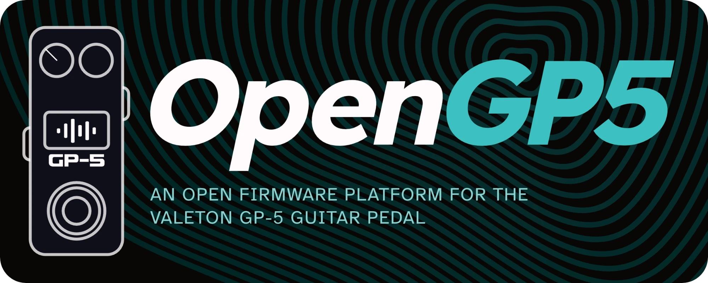
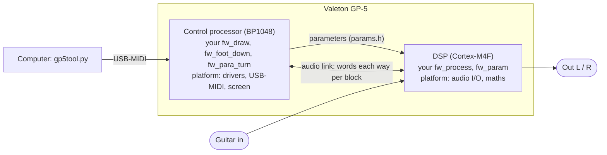

<p align="center">
  
</p>

<p align="center"><b>write your own effects · flash over USB</b></p>

<p align="center">
  <a href="LICENSE"></a>
  
  
</p>

<p align="center">
  <a href="https://opengp5.github.io/"><b>Documentation</b></a> ·
  <a href="https://opengp5.github.io/docs/get-started/"><b>Get started</b></a> ·
  <a href="https://opengp5.github.io/flasher/"><b>Flash from your browser</b></a> ·
  <a href="https://github.com/OpenGP5/Launchpad"><b>Launchpad (desktop app)</b></a> ·
  <a href="https://opengp5.github.io/docs/platform/first-effect/"><b>Your first effect</b></a> ·
  <a href="CHANGELOG.md">Changelog</a>
</p>

---

**OpenGP5** is open firmware for the Valeton GP-5 guitar pedal, written from scratch for both of its
processors, plus a small framework for writing your own: your audio code, your screen, your controls,
flashed over USB.

> [!NOTE]
> **Alpha.** Running on at least four GP-5s so far (users' reports, November 2026), with no problems reported.
> Expect rough edges, and expect interfaces to change. Reports from more GP-5s are very welcome (see [Known limits](docs/platform/known-limits.md)); read the
> [Safety](#safety) warning before you flash.

## Write an effect in plain C

The audio half of a firmware is three functions. A tremolo, for example:

```c
static void fw_process(const int32_t *in, int32_t *out_left, int32_t *out_right)
{
    for (uint32_t i = 0; i < GP5_BLOCK; i++) {                    /* 64 samples, every 1.45 ms */
        float wave = 0.5f + 0.5f * sinf(2.0f * GP5_PI * phase);
        float gain = 1.0f - depth * wave;
        phase += step; if (phase >= 1.0f) phase -= 1.0f;
        out_left[i] = out_right[i] = (int32_t)((float)in[i] * gain);
    }
}
```

Hear it before you flash it: `python3 tools/run_effect.py <firmware> guitar.wav out.wav` runs the same code,
with the same maths, on your computer.

## Quick start

**Try it without installing anything:** open the **[web flasher](https://opengp5.github.io/flasher/)** in Chrome, Edge or Opera on a
computer, plug the pedal in, pick one of the firmwares built with OpenGP5 (the tremolo example, or
[Dreamcatcher](https://github.com/OpenGP5/Dreamcatcher)), or upload a `.bin` (one you built, or Valeton's), and flash.
(Read [Safety](#safety) first.)

**Build your own:**

```bash
release/setup-toolchain.sh                    # both compilers, pinned and checksum-checked (~190 MB)
platform/build_firmware.sh tremolo            # -> build/GP-5_tremolo.bin
python3 tools/gp5tool.py flash build/GP-5_tremolo.bin --sections all
```

Requirements per system: **[Set up your computer](https://opengp5.github.io/docs/platform/setup/)**. Recovery and going back to Valeton's firmware: **[Recovery](https://opengp5.github.io/docs/get-started/recovery/)**.

## What's inside

| | |
|---|---|
| **Platform** (`platform/`) | Runs on both chips. Control processor: start-up, drivers, USB-MIDI, colour screen, foot switch, knobs, LEDs, storage (settings and files), the link to the DSP. DSP: start-up, audio in / out, floating-point maths, the link back. A computer can read the controls and change your settings live over USB. |
| **Firmwares** (`firmwares/`) | `passthrough`, the template to copy (start here) · `tremolo`, the example: parameters, presets, the screen and the controls, with a screen preview that runs on the computer. |
| **Built on OpenGP5** | [Dreamcatcher](https://github.com/OpenGP5/Dreamcatcher): ambient looper, glitch delay with grains, reverb, presets. [NAM Loader](https://github.com/OpenGP5/NAM-Loader): plays NAM A2 captures: 30 slots, 12 cab IRs. Each in its own repository. |
| **Desktop app** | [OpenGP5 Launchpad](https://github.com/OpenGP5/Launchpad): flash, back up and restore, manage presets and tones, with Valeton's firmware or any OpenGP5 one. |
| **Flasher** (`tools/gp5tool.py`) | Flashes your build or Valeton's own firmware over USB-MIDI, on macOS, Linux and Windows. |
| **Off-pedal tools** | `simulate.py` runs a whole firmware on the computer (both processors, the screen, scripted controls; [simulator](docs/platform/simulator.md)); `run_effect.py` runs your audio code on a WAV file; `dsp_emu_check.py` boots the built DSP firmware in an emulator; `make_font.py` turns any TrueType or BDF font into smooth screen text for your firmware ([fonts](docs/platform/fonts.md)). |

None of it comes from the chip vendor or from Valeton: no vendor SDK code, headers or libraries, and no
Valeton code or data. It was written from what the hardware does. The same source builds byte-identical
firmware on every supported system.

## How a firmware fits together



You write a manifest (`firmware.json`), your settings (`params.h`) and the two firmware files (the sound and the
controls); the platform does everything else: it carries the settings to the DSP, saves them, keeps presets, and
gives a computer an editor for them.
Walkthrough: **[Your first effect](docs/platform/first-effect.md)**. Your own firmware in its own repository, built
and tested on every push, buildable in the browser: start from the **[firmware template](https://github.com/OpenGP5/firmware-template)**.

## Documentation

**[opengp5.github.io/OpenGP5](https://opengp5.github.io/)**: getting started, Launchpad, the firmwares,
and building your own. The site is made from this repository: the pages for firmware authors are in
[`docs/platform/`](docs/platform/) (readable here too), the rest in [`site/`](site/).

| Read | For |
|---|---|
| [Get started](https://opengp5.github.io/docs/get-started/) | flash a firmware, recover, go back to Valeton's |
| [Launchpad](https://opengp5.github.io/docs/launchpad/) | the desktop app, page by page |
| [Firmwares](https://opengp5.github.io/docs/firmwares/) | NAM Loader, Dreamcatcher, the tremolo: what they do, their controls |
| [Build a firmware](https://opengp5.github.io/docs/platform/) | set up, how it works, your first effect, every guide and reference |
| [Help](https://opengp5.github.io/docs/help/) | problems, beta testing, contributing |
| [catalog/README.md](catalog/README.md) | listing your firmware so Launchpad and the web flasher offer it |

## Safety

> [!WARNING]
> Not affiliated with or endorsed by Valeton. Flashing your own firmware is at your own risk.
>
> The pedal's factory loader can't be overwritten over USB, so usually a bad flash is recoverable: unplug,
> hold the foot switch and the PARA knob, plug back in, and flash again (or put Valeton's firmware back
> with `gp5tool.py`).
>
> **In some circumstances, recovery needs an FT232H USB adapter wired to the pedal's internal debug
> pads, which takes some soldering experience.** Valeton's own updater (Valeton Suite) is not a reliable
> way back. Don't flash this firmware unless you are comfortable with the possibility of a bricked pedal.

## Licence

MIT, see [LICENSE](LICENSE). "Valeton" and "GP-5" are Valeton's trademarks, used here only to say which
pedal this runs on.
