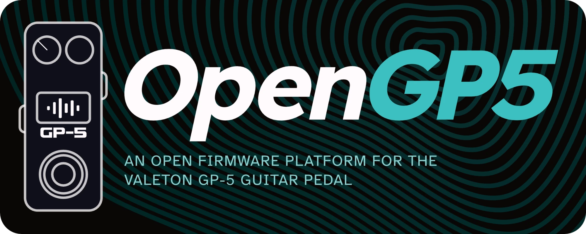
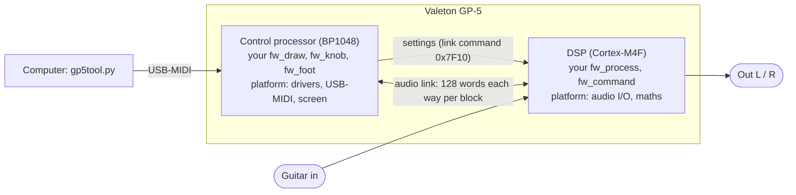

<p align="center">
  
</p>

<p align="center"><b>write your own effects · flash over USB</b></p>

<p align="center">
  <a href="LICENSE"></a>
  
  
</p>

<p align="center">
  <a href="https://opengp5.github.io/OpenGP5/flasher/"><b>Flash from your browser</b></a> ·
  <a href="GETTING-STARTED.md"><b>Getting started</b></a> ·
  <a href="docs/platform/first-effect.md"><b>Your first effect</b></a> ·
  <a href="docs/platform/protocols.md">Protocols</a> ·
  <a href="docs/platform/hardware.md">Hardware</a>
</p>

---

**OpenGP5** is open firmware for the Valeton GP-5 guitar pedal, written from scratch for both of its
processors, plus a small framework for writing your own: your audio code, your screen, your controls,
flashed over USB.

> [!NOTE]
> **Alpha.** Tested on one pedal so far. Expect rough edges, and expect interfaces to change. Reports from
> other GP-5s are very welcome (see [Known limits](GETTING-STARTED.md#known-limits)); read the
> [Safety](#safety) warning before you flash.

## Write an effect in plain C

The audio half of a firmware is three functions. A tremolo, for example:

```c
static void fw_process(const int32_t *in, int32_t *out_left, int32_t *out_right)
{
    for (uint32_t i = 0; i < GP5_BLOCK; i++) {                    /* 64 samples, every 1.45 ms */
        float wave = 0.5f + 0.5f * sinf(2.0f * GP5_PI * phase);
        float gain = 1.0f - depth * wave;
        phase += step; if (phase >= 1.0f) phase -= 1.0f;
        out_left[i] = out_right[i] = (int32_t)((float)in[i] * gain);
    }
}
```

Hear it before you flash it: `python3 tools/run_effect.py <firmware> guitar.wav out.wav` runs the same code,
with the same maths, on your computer.

## Quick start

**Try it without installing anything:** open the **[web flasher](https://opengp5.github.io/OpenGP5/flasher/)** in Chrome, Edge or Opera on a
computer, plug the pedal in, pick one of the firmwares built with OpenGP5 (the strobe tuner demo, or
[Dreamcatcher](https://github.com/OpenGP5/Dreamcatcher)), or upload a `.bin` (one you built, or Valeton's), and flash.
(Read [Safety](#safety) first.)

**Build your own:**

```bash
release/setup-toolchain.sh                    # both compilers, pinned and checksum-checked (~190 MB)
platform/build_firmware.sh tuner              # -> build/GP-5_tuner.bin
python3 tools/gp5tool.py flash build/GP-5_tuner.bin --sections all
```

Requirements per system, recovery and going back to Valeton's firmware: **[GETTING-STARTED.md](GETTING-STARTED.md)**.

## What's inside

| | |
|---|---|
| **Platform** (`platform/`) | Runs on both chips. Control processor: start-up, drivers, USB-MIDI, colour screen, foot switch, knobs, LEDs, the link to the DSP. DSP: start-up, audio in / out, floating-point maths, the link back. |
| **Firmwares** (`firmwares/`) | `passthrough`, the template to copy (start here) · `tuner`, a strobe tuner demo (guitar and 5-string bass) that uses every part of the platform, the audio link between the processors included. |
| **Built on OpenGP5** | [Dreamcatcher](https://github.com/OpenGP5/Dreamcatcher), an ambient texture firmware in its own repository: micro-looper, chance-driven glitch delay, presets, purple screen. |
| **Flasher** (`tools/gp5tool.py`) | Flashes your build or Valeton's own firmware over USB-MIDI, on macOS, Linux and Windows. |
| **Off-pedal tools** | `run_effect.py` runs your audio code on a WAV file; `dsp_emu_check.py` boots the built DSP firmware in an emulator; `make_font.py` turns a TrueType font into smooth screen text. |

None of it comes from the chip vendor or from Valeton: no vendor SDK code, headers or libraries, and no
Valeton code or data. It was written from what the hardware does. The same source builds byte-identical
firmware on every supported system.

## How a firmware fits together



You write the two firmware files (the sound and the controls); the platform does everything else.
Walkthrough: **[Your first effect](docs/platform/first-effect.md)**.

## Documentation

| Read | For |
|---|---|
| [GETTING-STARTED.md](GETTING-STARTED.md) | set up, build, flash, recover |
| [docs/platform/first-effect.md](docs/platform/first-effect.md) | your first effect, step by step |
| [platform/README.md](platform/README.md) | how a firmware plugs into the platform |
| [docs/platform/protocols.md](docs/platform/protocols.md) | USB-MIDI, the firmware update, the image format, the link between the processors |
| [docs/platform/hardware.md](docs/platform/hardware.md) | memory, pins and clocks of both processors |

## Safety

> [!WARNING]
> Not affiliated with or endorsed by Valeton. Flashing your own firmware is at your own risk.
>
> The pedal's factory loader can't be overwritten over USB, so usually a bad flash is recoverable: unplug,
> hold the foot switch and the PARA knob, plug back in, and flash again (or put Valeton's firmware back
> with `gp5tool.py`).
>
> **In some circumstances, recovery needs an FT232H USB adapter wired to the pedal's internal debug
> pads, which takes some soldering experience.** Valeton's own updater (Valeton Suite) is not a reliable
> way back. Don't flash this firmware unless you are comfortable with the possibility of a bricked pedal.

## Licence

MIT, see [LICENSE](LICENSE). "Valeton" and "GP-5" are Valeton's trademarks, used here only to say which
pedal this runs on.
