<p align="center">
  
</p>

<p align="center"><b>Open firmware for the Valeton GP-5 guitar pedal, written from scratch, and a framework for writing your own.</b></p>

<p align="center">
  <a href="https://github.com/OpenGP5/OpenGP5/releases"></a>
  
  <a href="LICENSE"></a>
  
</p>

<p align="center">
  <a href="https://opengp5.github.io/"><b>Documentation</b></a> ·
  <a href="https://opengp5.github.io/docs/get-started/"><b>Get started</b></a> ·
  <a href="https://opengp5.github.io/flasher/"><b>Flash from your browser</b></a> ·
  <a href="https://opengp5.github.io/docs/platform/first-effect/"><b>Your first effect</b></a> ·
  <a href="https://github.com/OpenGP5/OpenGP5/issues">Report a problem</a>
</p>

---

**OpenGP5** replaces the GP-5's software on both of its processors with code written from scratch, and gives you
a small framework for writing your own: your sound, your screen, your controls, flashed over USB. Nothing in it
comes from Valeton or the chip vendor, and you can always go back to Valeton's firmware.

> [!NOTE]
> **Alpha.** OpenGP5 has run on several GP-5s, with no problem reported. Expect rough edges, and expect interfaces
> to change before 1.0. Read [Before you flash](https://opengp5.github.io/docs/get-started/safety/) first.

## Try it

Pick a firmware built with OpenGP5 and put it on your pedal. Each turns the pedal into something new, and none
needs compilers:

| Firmware | What it is |
|---|---|
| [NAM Loader](https://github.com/OpenGP5/NAM-Loader) | Neural Amp Modeler captures: 30 of them, 12 cab IRs, a noise gate and EQ each |
| [Dreamcatcher](https://github.com/OpenGP5/Dreamcatcher) | Ambient textures: a micro-looper, a glitch delay that smears into reverb, grains |
| [Tremolo](firmwares/tremolo/) | The example firmware: small enough to read in one sitting |

Flash them with **[OpenGP5 Launchpad](https://github.com/OpenGP5/Launchpad)**, the desktop app (it also loads
captures, edits presets and backs up the pedal), or with the **[web flasher](https://opengp5.github.io/flasher/)**
in Chrome, Edge or Opera. Step by step: [Get started](https://opengp5.github.io/docs/get-started/).

## Write your own

The sound of a firmware is plain C. This is the whole sound of the tremolo:

```c
static void fw_process(const int32_t *in, int32_t *out_left, int32_t *out_right)
{
    for (uint32_t i = 0; i < GP5_BLOCK; i++) {                    /* 64 samples at a time */
        float wave = 0.5f + 0.5f * sinf(2.0f * GP5_PI * phase);
        float gain = 1.0f - depth * wave;
        phase += step; if (phase >= 1.0f) phase -= 1.0f;
        out_left[i] = out_right[i] = (int32_t)((float)in[i] * gain);
    }
}
```

Build it, try it on your computer, and flash it:

```bash
release/setup-toolchain.sh                    # once: both compilers, pinned and checksum-checked (~190 MB)
platform/build_firmware.sh tremolo            # -> build/GP-5_tremolo.bin
python3 tools/simulate.py tremolo             # the whole firmware on your computer: sound and screen
python3 tools/gp5tool.py flash build/GP-5_tremolo.bin --sections all
```

What each system needs: [Set up your computer](https://opengp5.github.io/docs/platform/setup/). To start a firmware
in its own repository, built and tested by GitHub on every push, use the
**[firmware template](https://github.com/OpenGP5/firmware-template)**.

### How a firmware fits together

```mermaid
---
config:
  look: classic
  layout: elk
  theme: "base"
  fontFamily: "Atkinson Hyperlegible Next, system-ui, sans-serif"
  themeVariables:
    darkMode: true
    background: "#090705"
    fontFamily: "Atkinson Hyperlegible Next, system-ui, sans-serif"
    fontSize: "15px"
    primaryColor: "#17151b"
    primaryTextColor: "#fffbfd"
    primaryBorderColor: "#3cc0c1"
    secondaryColor: "#17151b"
    tertiaryColor: "#0f0f1a"
    mainBkg: "#17151b"
    nodeBorder: "#3cc0c1"
    lineColor: "#3cc0c1"
    textColor: "#fffbfd"
    titleColor: "#fffbfd"
    clusterBkg: "#0f0f1a"
    clusterBorder: "#2c3036"
    edgeLabelBackground: "#090705"
  themeCSS: ".nodeLabel em { color: #9fe6e6; font-style: normal; } .nodeLabel strong { color: #fff; } .edgeLabel p, .edgeLabel span { color: #9fe6e6; font-size: 14px; }"
  flowchart:
    curve: "basis"
    padding: 18
    nodeSpacing: 48
    rankSpacing: 64
    wrappingWidth: 300
    htmlLabels: true
---
%% Keep the original architecture and details; use orthogonal routing to separate links.
flowchart TB
    subgraph chart[" "]
        direction TB
        pc(["`**Computer**

Launchpad or gp5tool.py`"])
        guitar(["Guitar in"])

        subgraph pedal["<div style='width:360px;text-align:left'>Valeton GP-5</div>"]
            direction TB
            ctl["`**Control processor · BP1048**

_Your code:_ fw_draw, fw_foot_down, fw_para_turn

_The platform:_ drivers, USB-MIDI, screen, controls and storage`"]
            dsp["`**DSP · Cortex-M4F**

_Your code:_ fw_process, fw_param

_The platform:_ audio in and out, maths`"]

            ctl -- "Settings<br/>params.h" --> dsp
            ctl <-- "Audio link<br/>words each way<br/>per block" --> dsp
        end

        pc -- "USB-MIDI" --> ctl
        guitar --> dsp
        dsp --> out(["Out L / R"])
    end

    classDef default fill:#17151b,stroke:#3cc0c1,color:#fffbfd,stroke-width:1.5px,rx:10,ry:10;
    style chart fill:#090705,stroke:#2c3036,rx:14,ry:14;
    style pedal fill:#090705,stroke:#2c3036,color:#9fe6e6,rx:14,ry:14;
    linkStyle default stroke:#3cc0c1,stroke-width:1.5px;
```



You write a manifest (`firmware.json`), your settings (`params.h`), the sound (`dsp/firmware.h`) and the controls
and screen (`nds32/firmware.c`). The platform does everything else: it carries your settings to the DSP, saves
them, keeps presets, and gives Launchpad an editor for them. Walkthrough:
[Your first effect](https://opengp5.github.io/docs/platform/first-effect/).

## What's inside

| | |
|---|---|
| **Platform** (`platform/`) | Runs both processors. Control processor: start-up, drivers, USB-MIDI, the colour screen, foot switch, knobs, LEDs, storage (settings and files), the link to the DSP. DSP: start-up, audio in and out, floating-point maths, the link back |
| **Firmwares** (`firmwares/`) | `tremolo`, the example (settings, presets, the screen and controls), and `passthrough`, the smallest possible firmware |
| **Flasher** (`tools/gp5tool.py`) | Flashes your build, or Valeton's own firmware, over USB-MIDI on macOS, Linux and Windows |
| **Tools for the computer** | `simulate.py` runs a whole firmware (both processors, the screen, scripted controls); `run_effect.py` runs your sound on a WAV file; `dsp_emu_check.py` boots the built DSP firmware in an emulator; `make_font.py` turns a font into smooth screen text |
| **Web flasher** (`docs/flasher/`) | Flashing from the browser, served at [opengp5.github.io/flasher](https://opengp5.github.io/flasher/) |
| **Catalog** (`catalog/`) | The firmwares Launchpad and the web flasher offer. [List yours](catalog/README.md) |
| **Documentation** (`site/`, `docs/platform/`) | The website. The pages for firmware authors are in `docs/platform/`, readable here too |

None of it comes from the chip vendor or from Valeton: no vendor SDK code, headers or libraries, and no Valeton
code or data. It was written from what the hardware does. The same source builds byte-identical firmware on every
supported system.

## Documentation

Everything is on **[opengp5.github.io](https://opengp5.github.io/)**:

| Read | For |
|---|---|
| [Get started](https://opengp5.github.io/docs/get-started/) | Flash a firmware, recover from a failed flash, go back to Valeton's firmware |
| [Launchpad](https://opengp5.github.io/docs/launchpad/) | The desktop app, page by page |
| [Firmwares](https://opengp5.github.io/docs/firmwares/) | NAM Loader, Dreamcatcher and the tremolo: what they do, their controls |
| [Build a firmware](https://opengp5.github.io/docs/platform/) | Setting up, how a firmware works, your first effect, every guide and reference |
| [Help](https://opengp5.github.io/docs/help/) | Problems, beta testing, contributing, the changelog |

## Safety

> [!WARNING]
> Flashing your own firmware is at your own risk. The pedal's factory loader can't be overwritten over USB, so a
> bad flash can almost always be undone: unplug the pedal, hold the foot switch and press PARA in while you plug it
> back in, and flash again ([Recovery](https://opengp5.github.io/docs/get-started/recovery/)).
>
> **In rare cases, recovery needs an FT232H USB adapter wired to the pedal's internal debug pads, which takes some
> soldering experience.** Valeton's own updater (Valeton Suite) is not a reliable way back. Don't flash unless
> you're comfortable with that small risk.

## Licence

MIT (`LICENSE`). Contributions are welcome: see [CONTRIBUTING.md](CONTRIBUTING.md).

Not affiliated with or endorsed by Valeton. "Valeton" and "GP-5" are Valeton's trademarks, used only to say which
pedal this runs on.
