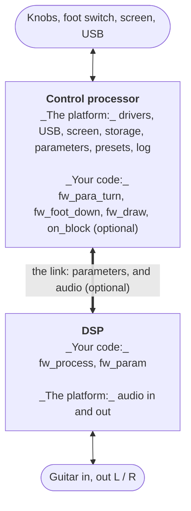
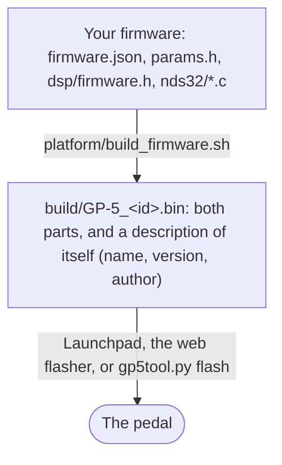

# How an OpenGP5 firmware works

This guide explains the two chips, the shared code, and how your effect uses them.
Start here if you have not worked with the GP-5 hardware.

## Two processors

The GP-5 has two processors. A build has code for each one.
The **digital signal processor (DSP)** handles audio. The **control processor** handles the screen,
controls, USB and storage. It can also process audio through the audio link.

| Part | DSP | Control processor |
|---|---|---|
| Chip | Arm Cortex-M4F, about 192 MHz | Andes NDS32 (BP1048), 288 or 320 MHz |
| Main task | Mono guitar input, stereo output | Screen, knobs, foot switch, LEDs, USB and storage |
| Your code | `dsp/firmware.h` | `nds32/*.c` |
| Calls | `fw_process()` for each 64-sample block | Control callbacks and `fw_tick()` every 10 ms |
| Firmware RAM budget | 19,712 bytes for variables; 122,880 for buffers | 264,160 bytes for data; code runs from flash |

A block lasts 1.45 ms at 44.1 kHz or 1.33 ms at 48 kHz.
The [API version notes](api.md#versions) explain the memory guarantee for 1.x.

## The platform

The platform is the code both halves use for start-up, hardware access, USB, storage and the processor link.
Your effect can use these tools without changing the platform.
A **callback** is a function you write that the platform calls at a set time or on an event.

**Callbacks must not wait for events or contain loops that block other work.**
Aim to finish a main-loop pass within one or two audio blocks. Draw the screen in strips so controls and USB
can run between draws. `fw_draw` returns a non-zero value when it has more to draw.
See [Performance](performance.md) for the separate audio deadlines.

## Settings: parameters

Declare each setting as a **parameter** in `params.h`. The platform can then:

- send a changed value to the DSP through `fw_param()`;
- keep values marked for saving across power-off;
- store values marked for presets in named slots;
- let a computer read and change them.

Launchpad builds its Live editor from this list. See [Parameters and presets](params.md).

## Sound on both chips: the audio link

The **audio link** exchanges 32-bit words after each audio block.
Send guitar samples to the control chip, process them there, then read the result on the DSP.
The result returns three blocks later: about 4.4 ms at 44.1 kHz or 4 ms at 48 kHz.

NAM Loader and Dreamcatcher share sound work this way. The control chip has more memory and can run
some sound code faster. See [The audio link](audio-link.md).

## USB audio and Bluetooth

A firmware built for 1.0 is also a USB audio interface: the computer records its finished sound and can play
through the pedal. It uses 64 words of the audio link each way, which the platform keeps for it. Set
`"usb_audio": false` in `firmware.json` to turn it off and get them back. See [USB audio](api.md#usb-audio).

With `"bluetooth": true`, the pedal also takes MIDI over Bluetooth: Launchpad and the phone remote can change
settings and presets without a cable. See [Bluetooth](api.md#bluetooth).

## Storage

The installed build owns about 300 KB of storage. Its `id` in `firmware.json` marks the storage as its own.

- An update with the same ID keeps storage. Changes to parameter names can reset those settings.
- A different ID starts with empty storage.
- Returning to Valeton's firmware restores its factory preset layout. Restore a backup to get your own presets back.

The platform saves parameters marked with a save flag. Use store records for other small data, up to 1 KB per record.
Use files for larger data that a computer writes, such as captures. See [Storage](storage.md).

## What happens at power-on

1. The control chip starts the platform and checks which build the storage belongs to. It loads saved parameters, then calls your `fw_init()`.
2. It starts the DSP, which calls its own `fw_init()`. The DSP starts with defaults from `params.h`.
   The control chip then sends the saved values before audio fades in.
3. The DSP calls `fw_process()` for each block. The control chip runs its main loop for callbacks,
   parameter changes, saving, USB and the screen.

## From code to pedal

Use `tools/simulate.py` to check the sound, screen and controls on your computer before flashing.
See [The simulator](simulator.md). For a pedal that fails to start, follow
[Recovery](../../GETTING-STARTED.md#recovery), including the known DSP update fault.

Next, build [Your first effect](first-effect.md), or start a separate repository with the
[firmware template](https://github.com/OpenGP5/firmware-template).
