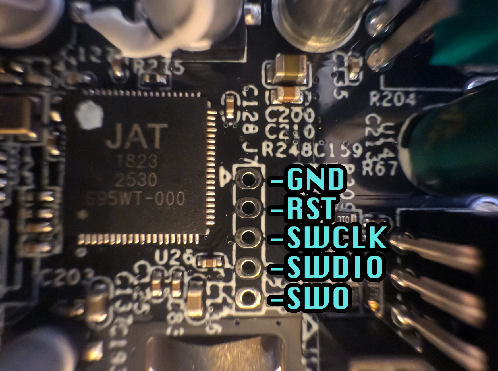

# J7 recovery

Some GP-5s have a DSP updater fault that blocks firmware updates, including Valeton's updates.
The flasher may report "stopped acknowledging at the erase of the dsp section", or Valeton Suite may remain at 0 %.
This guide uses a USB debug adapter to get past the fault, install OpenGP5, and write a permanent fix.
The DSP is the digital signal processor that handles sound.

**Symptoms** (all of them):

- The flash stops at the start of a DSP part (`dsp`, `dsp-data` or `models`), before anything is written to it.
- It happens every time, with every tool: Launchpad, the web flasher, `gp5tool.py`, Valeton Suite.
- The app part (`app`) and the presets (`presets`) on their own do flash.

If the pedal starts after you unplug and reconnect it, its old build still runs.
Use this guide to get past the fault when installing a new build. A pedal stuck on **BOOTLOAD** may need it to start again.

**Cause.** After the DSP updater resets its flash memory, a brief read fault can send its timer to the wrong address.
The updater then waits for a counter that does not change. The fix changes four bytes so the counter uses an address
that avoids the fault. You need to run OpenGP5 on the pedal to apply it.

> **Risk.** This procedure means opening the pedal, wiring J7 and using a debugger. Wiring errors can damage the pedal.
> Step 2 reads memory. Step 3 changes RAM for one powered session. Step 4 flashes firmware, and step 6 writes a
> permanent change to the DSP updater. The tools check for the known updater before applying its fix.
> Stop if those checks fail.

## What you need

- An **FT232H** USB board (the common "CJMCU-232H" or Adafruit FT232H breakout).
- Three short wires. Soldering them to J7 is the most reliable; small test clips or header pins pressed into the
  holes can work.
- A computer with **Python 3.9 or later** and **OpenGP5's tools** (the `tools` folder from the OpenGP5 download:
  `pip install mido python-rtmidi`).
- An **OpenGP5 firmware image** (`.bin`) with `tickfix` support, such as the current tremolo, Dreamcatcher or NAM Loader build.
  These docs target platform 0.8.0-alpha and its planned 1.0 API.
- **OpenOCD**, the debugger program:
  - macOS: `brew install open-ocd`
  - Linux: `sudo apt install openocd` (or your distribution's package)
  - Windows: OpenOCD from the xPack project (`xpack-openocd`), and once, the **WinUSB** driver for the FT232H with
    [Zadig](https://zadig.akeo.ie/) (pick the FT232H's "Interface 0", WinUSB, "Replace driver").

## Wiring

J7 is a row of five holes on the main board, next to the chip marked **JAT** (the DSP). Pin 1 is marked with a
triangle.



| J7 pin | Signal | FT232H |
|---|---|---|
| 1 (triangle) | GND | GND |
| 2 | RST | not connected |
| 3 | SWCLK | AD0 |
| 4 | SWDIO | AD1 and AD2, joined |
| 5 | SWO | not connected |

Join AD1 and AD2 on the FT232H with a short wire, and run one wire from there to pin 4. No resistors are needed.
Some FT232H boards label the pins D0, D1, D2 instead of AD0, AD1, AD2.

Plug the pedal and the FT232H into the same computer so they share a ground. The pedal can be powered from its USB
cable as usual.

## Steps

Run these in the OpenGP5 folder (where `tools` is).

**1. Enter update mode and check the status.** Unplug the pedal. Press and hold the **foot switch** and **PARA**.
Plug it back in, then release both controls. Confirm the mode with the tool below; do not rely on the screen alone.
A pedal on the BOOTLOAD screen may already be in update mode.

```bash
python3 tools/gp5tool.py status
```

Expected result: `update mode`.

**2. Check for the known stall.** This step reads memory without changing it.

```bash
python3 tools/j7_nudge.py check
```

Expected result: `The DSP's updater is stalled the known way`.
For a connection error, see [Troubleshooting](#troubleshooting).

**3. Apply the temporary RAM change.** This gets the updater past the stall for this powered session.
Unplugging clears the change:

```bash
python3 tools/j7_nudge.py nudge
```

Expected result: `Done: the updater's timer counts again`.

**4. Flash the full OpenGP5 image.** Keep the pedal powered after step 3:

```bash
python3 tools/gp5tool.py flash GP-5_tremolo.bin --sections all
```

Use the path to your chosen image in place of `GP-5_tremolo.bin`. It must support `tickfix`.
Expected result: the flash completes, including its DSP section.

**5. Start the installed build.** Unplug and reconnect the pedal without holding the controls.
Expected result: the new OpenGP5 build starts.

**6. Check and apply the permanent fix.** The first command reads its state. The second writes four bytes
to the DSP updater in two small writes, without an erase:

```bash
python3 tools/gp5tool.py tickfix
python3 tools/gp5tool.py tickfix --apply
```

Expected results: `not applied`, then `applied: updates won't stall`.
If the first command says the fix is already applied, you do not need to apply it again.

**Finish.** Unplug the pedal and adapter before removing the wires.
The permanent fix lets this updater complete the USB flash steps that the fault blocked.
Run `gp5tool.py tickfix` to check the fix's state. Other flash faults still need their own checks.

## Troubleshooting

- **OpenOCD can't connect** ("Error connecting DP", no DAP info): check the three wires first. If they're right,
  unplug both devices before checking the SWCLK and SWDIO connections against the pin table. On Linux, OpenOCD may need permission for USB devices (run it
  once with `sudo`, or add a udev rule for `0403:6014`). On Windows, the FT232H needs the WinUSB driver (Zadig).
- **`check` says it isn't the known stall:**
  - `pc ... isn't in the updater's wait`: the pedal isn't in update mode, or it isn't stalled (it may be a pedal
    that doesn't have this problem). Do step 1 again.
  - `the vector table was already moved`: you already ran `nudge` in this session: go on with step 4.
  - `the DSP's vector table isn't the one this was made for`: your pedal's updater is a different version from
    the one this fix was made on. **Stop here** and report it (below): nothing was changed.
- **`tickfix --apply` says the updater "isn't the known one"**: the same: report it, nothing was written.
- **The flash in step 4 still stops**: unplug the pedal, start again at step 1, and report it with the output.

## Reporting results

Whether it worked or not, please open a [hardware report](https://github.com/OpenGP5/OpenGP5/issues/new/choose) with
the output from `j7_nudge.py check` and `gp5tool.py tickfix`. Include the pedal and tool versions.
Reports help track which pedals have the fault and which updater versions the fix supports.
