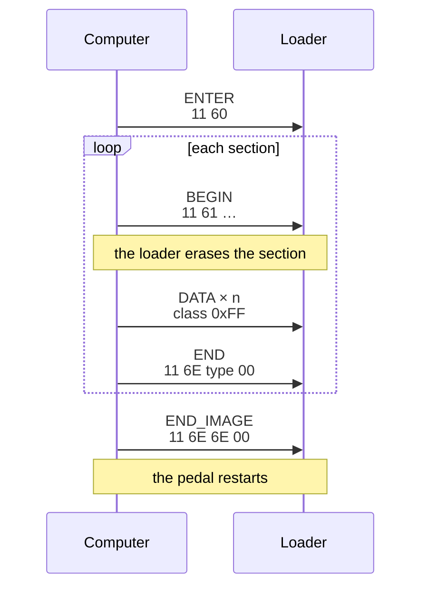

# Protocols

Everything the platform and the flasher speak. Reference implementations: `tools/gp5_flash.py`
(framing), `tools/gp5tool.py` (update session), `tools/htfw.py` (image format),
`platform/nds32/proto.c` + `platform/nds32/dsp_link.c` (control-processor side),
`platform/dsp/responder.c` (DSP side).

## 1. USB-MIDI framing

The pedal is a USB-MIDI device. Every message, in both directions, is one SysEx message:

```
F0  <body, every byte sent as two bytes: high nibble, then low nibble>  F7

body = crc8, class, index, length, payload[length]
crc8 = CRC-8, polynomial 0x07, initial value 0, not reflected,
       over the bytes 00, class, index, length, payload
```

Classes: `0x01` = command (index 0), `0xFF` = update data (index = packet number, 8 bits, wrapping).
The pedal acknowledges update traffic with the payload `14 08 00`; a non-zero third byte asks for the
frame again.

## 2. Commands the open firmware answers (class 0x01)

| request payload | answer | does |
|---|---|---|
| `11 6F` | `14 08 00` | restart into the factory loader's USB update mode (nothing is written) |
| `7E 00` | `7E 00 <ok> <version u32>` | the DSP firmware's version (platform DSP: `0x00010000`) |
| `7E 01` | `7E 01 <counters> <last frame>` | DSP link counters: frames, errors, ACKs, NAKs since start-up |
| `7E 03 <off u16> <bytes…>` | `7E 03 <ok>` | stage up to 60 bytes of a DSP link payload at `off` |
| `7E 04 <len u16> <wait>` | `7E 04 <status> <n> <reply…>` | send the staged payload to the DSP and wait up to `wait` × 10 ms; status 1 = reply frame, `0x14` = ACK, `0x13` = NAK, 0 = no answer |
| `7E 05 <addr u32> <count>` | `7E 05 <ok> <bytes…>` | read up to 64 bytes of the control processor's flash (below 2 MB, memory-mapped; reads only) |
| `7E 06` | `7E 06 1 <JEDEC id u32> <status u32>` | the flash chip's id and status register 1 |
| `7E 09 <addr u32> <count>` | `7E 09 <ok> <bytes…>` | the same as `7E 05`, read with the flash controller's read command (a driver check) |
| `7E 07 <addr u32>` | `7E 07 <ok>` | erase a 4 KB sector of the storage area, 0x13F000–0x189FFF (any other address is refused; `storage.md`) |
| `7E 08 <addr u32> <bytes…>` | `7E 08 <ok>` | program up to 56 bytes (a multiple of 4) in the storage area |
| `7E 0D` | `7E 0D 1 <major> <minor> <patch> <name…> 0` | which firmware this is (platform 0.2.2 and later): the platform's version and the firmware's name (1.0: the manifest's `id`; before: `fw_name()`) |
| `7E 0E <firmware id u32>` | `7E 0E <reloaded>` | the computer rewrote a store record (0.2.2+): the firmware's `fw_store_changed(id)` (1.0: `fw_storage_changed()`; parameter records the platform reloads itself) loads it again (1) or can't (0: restart the pedal) |
| `7E 10 <id u16> <value u32>` | `7E 10 <taken>` | set a value live (0.5.4). 1.0 firmwares: a parameter (`params.md`; clamped, sent to the DSP, saved), ids past the parameters go to `fw_param_set`; 0 = not taken. Launchpad's Live page |
| `7E 11 <first u16> <count>` | `7E 11 <n> <values × n, 16 bits each>` | read values (0.5.4), at most 40; parameters are signed. `n` stops at the first id the firmware doesn't know |
| `7E 0F` | `7E 0F 1 <knob> <foot> <para>` | the controls (0.5.2+): volume knob 0..255 (filtered, as `gp5_knob()` gives it), foot switch and PARA push pressed now (0/1, not debounced). Launchpad turns its drawn knob with it |
| `7E 12 <id u16>` | `7E 12 1 <count u16> <id u16> <flags> <unit> <min i16> <max i16> <default i16> <name> 0 <group> 0 <choices> 0` | describe parameter `id` (1.0, `params.md`); `7E 12 0` past the last one. Choices are `A\|B\|C` |
| `7E 15 <id u16> <value i16>` | `7E 15 1 <text> 0` | the text of a value (1.0, `GP5_U_CUSTOM`: the firmware's `fw_param_text`); `7E 15 0` when it has none |
| `7E 17 0` | `7E 17 1 <count> <current> <dirty> <used u64>` | presets (1.0): how many, the one loaded (`FF` = none), changed since (0/1), a bit per preset that holds a sound |
| `7E 17 1 <n>` / `7E 17 2 <n>` | `7E 17 <done>` | load / save preset `n` |
| `7E 17 3 <n>` | `7E 17 1 <name> 0` | preset `n`'s name |
| `7E 17 4 <n> <name…>` | `7E 17 <done>` | rename preset `n` (printable ASCII, up to 12) |
| `7E 16 <offset u16>` | `7E 16 1 <total u16> <up to 48 bytes>` | the firmware's metadata block from `offset` (1.0; `7E 16 0` for a firmware without a manifest). Format: `"GP5META1"`, length u32, the manifest as JSON, NUL, padding to 4, CRC-32 of the JSON (`platform/manifest.py`) |
| `7E 14 [1]` | `7E 14 1 <15 values, u32 each>` | load and memory (1.0). Control processor: cycles per block, audio-link handler last and worst, main loop's longest pass (cycles), RAM used, RAM total. DSP: answered (0/1), cycles per block, last block, worst, late blocks, variables used and total, `GP5_LARGE` used and total. With `1`: start the worst values again |
| `7E 18 <from u32>` | `7E 18 1 <at u32> <end u32> <n> <n bytes>` | the log (1.0, `gp5_log`), from byte `from`. `at` = where the bytes start (the oldest kept, if `from` was overwritten), `end` = bytes written since start-up; ask again from `at + n` |

`tools/gp5_link.py` wraps `7E 00`, `7E 01`, `7E 03` / `7E 04`, `7E 05` (`flash-read`) and the 1.0 commands
(`info`, `params`, `set`, `presets`, `preset`, `log`, `status`). `tools/gp5tool.py info` reads `7E 16` too.

Valeton's own firmware and the factory loader answer the state query `12 30` with `11 30 01 00`
(Valeton's app) or `11 30 01 01` (update mode); the open firmware does not answer it. `gp5tool.py status`
uses this, plus the USB port name ("GP-5 Open FW"), to tell the three apart.

**How the commands grow (from 1.0):** an answer only ever gets longer, by fields added at its end; a field never
moves or changes meaning, and a command keeps its number. Readers take the fields they know and ignore any bytes after
them (Launchpad, `gp5_link.py` and the web flasher do). New things get new commands, or new sub-commands such as
`7E 17 5`. So an older Launchpad keeps working with a newer pedal, and the other way round.

## 3. Firmware update session (factory loader)

Started by `11 6F` from the open firmware (or Valeton's), or by holding the foot switch and the PARA knob
while plugging the pedal in. In update mode the screen stays dark. One session writes one or more
sections; every frame waits for its `14 08 00`:

> A firmware that has run the audio link (`gp5_link_start`) cannot hand over to the loader directly: the
> loader starts, but crashes once the computer connects (cause not found yet). So for `11 6F` the platform
> first restarts the chip with a mark in the top 32 bytes of RAM (`0x20047FE0`, kept out of the app's RAM),
> and the next start, which sees the mark before the link or the firmware runs, hands over. It takes about
> one second longer; the tool and the web flasher wait for it.



- **BEGIN**: `11 61 <type> 00 00 00 <packet count u32> <length u32>`.
- **DATA**: class `0xFF`, index = the packet number; each packet carries 19 bytes: `11 <type>`, then the section's data.
- **END**: `11 6E <type> 00`. Then BEGIN … END for the next section (dsp, app, …).

`length` counts the two leading bytes `11 <type>`. The loader can only write the sections below; its own
code (flash `0x0`–`0xFFFF`) is out of reach, which is why recovery with Foot + PARA always works.

| section | type | where it goes | largest accepted |
|---|---|---|---|
| dsp (DSP firmware) | `0x63` | DSP flash `0x4000` | 64 KB |
| dsp-data (Valeton) | `0x67` | DSP flash | 1 MB |
| models (Valeton) | `0x66` | DSP flash | 268 KB |
| app (control processor) | `0x62` | flash `0x10000` | 1,440 KB |
| presets (Valeton) | `0x65` | flash `0x190000` | – |

## 4. Image format (`.bin`)

Valeton's updates and this project's builds use the same container. Little-endian:

```
0x00  'HTFW'                     0x0C  product name, 16 bytes ("GP-5")
0x08  u32 total file size        0x1C  'V' major minor patch (shown by Valeton's updater only)
0x21  u8 compression (0 = none)  0x22  u8 section count       0x24  u32 payload length
0x38  section table, 16 bytes per section:
        u16 CRC-16/MODBUS of the data, stored byte-swapped, u8 0, u8 type,
        u32 flash address, u32 offset of the data after the table, u32 length
      then the section data, in table order
```

A Valeton image has all five sections; a platform build has only `dsp` and `app`. The order and
addresses are fixed (table above, in that order); `gp5tool.py check` validates an image without a pedal.

## 5. Link between the processors (UART)

The control processor's UART0 (pins A0 receive / A1 transmit) and the DSP's UART0 (`0x40005000`):
460800 baud, 8N1. Frames in both directions:

```
[crc8][length u16 = whole frame][01][payload]        crc8 as in section 1, over the payload only
payload = [cmd u16][len u16][fields…]
status-only answer: 01 04 00 14 = ACK, 01 04 00 13 = NAK (bad CRC or length)
```

Commands the platform uses:

| cmd | from | payload / answer |
|---|---|---|
| `0x6000` | control | version query, `[cmd][8][0 u32]` → `[cmd][12][1 u32][version u32]`. The control side waits for this answer before anything else. |
| `0x1001` | control | output level: `[cmd][12][sub 0 u32][f32 0.0 … 1.0]` → ACK. The DSP is muted until it gets one. |
| `0x4001` | DSP | a 24-byte status frame about every 43 ms (zeros today); not answered |
| `0x7F01` / `0x7F02` | control | DSP flash tick patch: status / apply (see `platform/dsp/tickpatch.h`) |
| `0x7F04` | control | DSP load: `[cmd][8]` or `[cmd][12][1 u32]` (then start the worst again) → `[cmd][24][cycles last block][worst since start-up][late blocks][variables in use, bytes][GP5_LARGE in use, bytes]` (1.0: the last two) |
| `0x7F10` | control | a parameter (1.0): `[cmd][12][id u32][value u32]` → ACK; the DSP keeps it and calls `fw_param()` |
| `0x4F10` | DSP | a log line (1.0, `gp5_log`): `[cmd][len][text]`, not answered; the control processor adds it to its log as `dsp: …` |
| `0x7F11` … `0x7FFF` | control | the firmware's own commands, handed to `fw_command()` (`platform/dsp/gp5_dsp.h`; from `0x7F10` for a firmware without parameters) |

Any other command is acknowledged.
