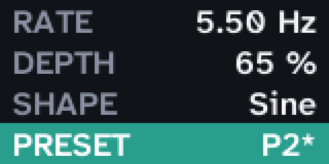
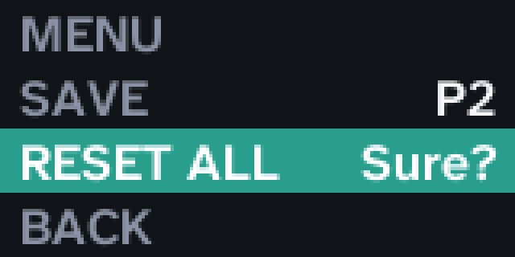

# The UI kit

The UI kit in `platform/nds32/gp5_ui.h` provides screen and control tools built on [parameters](params.md).
Use the pieces you need. Unused kit code takes no space in the built image.
Dreamcatcher, for example, draws its own screen.

| Tool | Purpose |
|---|---|
| `gp5_param_format()` | a value as text, the way Launchpad shows it |
| `gp5_ui_page_t` | a settings page: a row per parameter, PARA picks and adjusts |
| `gp5_ui_page_message()` | a short message in the page's last row |
| `gp5_ui_menu_t` | a menu of actions: PARA picks, a click runs one, risky ones ask "Sure?" first |
| `gp5_pickup_t` | Knob pickup: wait until the knob reaches the current value before it takes control |

## A settings page

```c
#include "gp5_ui.h"
#include "fonts/sans_16.h"

static const uint8_t rows[] = { GP5_P_RATE, GP5_P_DEPTH, GP5_P_SHAPE, GP5_UI_PRESETS };
static gp5_ui_page_t page = { .rows = rows, .n = 4, .font = &gp5_font_sans_16, .row_h = 20, .upper = 1 };

void fw_para_turn(int d) { gp5_ui_page_turn(&page, d); }
void fw_para_click(void) { gp5_ui_page_click(&page); }
int fw_draw(int force)   { return gp5_ui_page_draw(&page, force); }
```



How it works on the pedal:

- **Turn PARA** to pick a row. The row picked is highlighted, and the page scrolls when there are more rows than fit.
- **Press PARA** to adjust it. A bar on the left and `< >` around the value show you're adjusting. Turning now changes the
  value; press PARA again to finish.
- Numbers stop at their range, choices go round, and read-only parameters can't be adjusted.
- **The presets row** (`GP5_UI_PRESETS`, if the manifest has `"presets"`) shows `P2 name`, with `*` when the sound
  differs from it. Adjusting it loads presets as you turn; empty ones are shown but not loaded. Saving is the
  firmware's choice of control. The tremolo saves on a PARA hold:

```c
void fw_para_hold(void)
{
    if (gp5_preset_save(gp5_ui_page_preset(&page))) gp5_ui_page_message(&page, "Saved", 1500);
}
```

What you can set (leave anything else 0 for its default):

| Field | Meaning |
|---|---|
| `rows`, `n` | the rows: parameter ids and `GP5_UI_PRESETS`. Without `rows`, every parameter that isn't `GP5_P_HIDDEN`, then the presets |
| `steps` | per row, how much one click changes it. Default: about 1/50 of the range, rounded to 1, 2, 5, 10, 20 …; values stay on that grid |
| `font` | required: a font your firmware includes (`fonts.md`) |
| `row_h` | row height; default the font's line height. `sans_16` with 20 px rows gives 4 rows; `sans_12` with 16 px gives 5 |
| `y`, `h` | the part of the screen the page uses (default: all of it), e.g. below a header you draw yourself |
| `title` | a title row at the top |
| `upper` | labels in capitals |
| `theme` | colours: `{ bg, ink, dim, accent, on_accent }` as `0xRRGGBB`; default dark grey, white and teal |
| `faded` | set to 1 to grey the values out, e.g. while the effect is bypassed; the page redraws when it changes |

`gp5_ui_page_draw` draws one changed row per call and returns non-zero while more are left, like any `fw_draw`.
Return that result from your `fw_draw`. The page also shows changes from preset loads and the computer.
Use `gp5_ui_page_row()` to find the selected row if your screen needs more detail.

## A menu

A menu lists actions such as save, reset and back. Turn PARA to select an item, then press PARA to run it.
For an item marked `confirm`, the menu asks "Sure?". Press PARA again to confirm.
Turn away or wait three seconds to cancel. An item's `value()` shows text on the right, such as the target preset.



The tremolo's page with a menu on a PARA hold (it runs as it is in the simulator):

```c
static const uint8_t rows[] = { GP5_P_RATE, GP5_P_DEPTH, GP5_P_SHAPE, GP5_UI_PRESETS };
static gp5_ui_page_t page = { .rows = rows, .n = 4, .font = &gp5_font_sans_16, .row_h = 20, .upper = 1 };
static int in_menu, switched;                    /* switched: draw everything once after a switch */

static void close_menu(void) { in_menu = 0; switched = 1; }
static void save(void)
{
    if (gp5_preset_save(gp5_ui_page_preset(&page))) close_menu(), gp5_ui_page_message(&page, "Saved", 1500);
}
static void reset(void)
{
    for (unsigned id = 0; id < GP5_NPARAMS; id++) gp5_param_set(id, gp5_param_table[id].def);
    close_menu(); gp5_ui_page_message(&page, "Reset", 1500);
}
static const char *save_slot(void)               /* the preset "Save" writes to: the one the page shows */
{
    static char t[4] = "P1";
    t[1] = (char)('1' + gp5_ui_page_preset(&page));
    return t;
}
static const gp5_ui_item_t items[] = {
    { "Save", save, save_slot, 0 },
    { "Reset all", reset, 0, 1 },                /* asks for a second click */
    { "Back", close_menu, 0, 0 },
};
static gp5_ui_menu_t menu = { .items = items, .n = 3, .font = &gp5_font_sans_16, .row_h = 20, .upper = 1, .title = "MENU" };

void fw_para_turn(int d) { if (in_menu) gp5_ui_menu_turn(&menu, d); else gp5_ui_page_turn(&page, d); }
void fw_para_click(void) { if (in_menu) gp5_ui_menu_click(&menu); else gp5_ui_page_click(&page); }
void fw_para_hold(void) { in_menu = !in_menu; switched = 1; if (in_menu) gp5_ui_menu_pick(&menu, 0); }

int fw_draw(int force)
{
    if (switched) { force = 1; switched = 0; }
    return in_menu ? gp5_ui_menu_draw(&menu, force) : gp5_ui_page_draw(&page, force);
}
```

| Item field | Meaning |
|---|---|
| `label` | the item's name |
| `run` | called on a click (or the second click, with `confirm`); 0 for an item that only shows something |
| `value` | optional: a function returning the text on the right; asked whenever the menu draws, so it can change |
| `confirm` | 1: ask "Sure?" first |

The menu takes the same `font`, `theme`, `title`, `y`, `h`, `row_h` and `upper` as the page.
`gp5_ui_menu_message()` shows a message in its last row, `gp5_ui_menu_pick()` picks an item (the first, say, when the
menu opens) and `gp5_ui_menu_item()` says which is picked.

## Value text

```c
char t[16];
gp5_param_format(GP5_P_TIME, gp5_param(GP5_P_TIME), t);     /* "350 ms", "1.50 s" */
```

The formatter shows choice names and the same units as Launchpad: `50 %`, `-6 dB`, `+5.5 dB`, `440 Hz`, `+7 st`. For
`GP5_U_CUSTOM` it asks your `fw_param_text()`, so the screen and Launchpad always agree.

## Knob pickup

A physical knob may point to a different value from the saved setting.
Use pickup to wait until the knob crosses the saved value before it takes control.
This avoids a jump when you load a preset or give the knob a new task:

```c
static gp5_pickup_t knob;

void fw_init(void) { gp5_level_own(1); gp5_level_set(255); gp5_pickup_start(&knob, GP5_P_MIX); }
void fw_tick(void) { gp5_pickup_poll(&knob); }
```

The value stays fixed until the knob crosses it. The knob then controls the whole range.
Call `gp5_pickup_start` again after a preset load or when assigning another setting.
Call `gp5_level_own(1)` to stop the knob from also changing output level.
This helper waits for a value crossing; Dreamcatcher's own control code uses a movement threshold instead.

## Trying it without a pedal

`python3 tools/simulate.py <firmware> --script s.txt` runs your page and menu with scripted controls and saves the
screens ([simulator](simulator.md)). `firmwares/tremolo/test/screen.sh` runs the tremolo's control half on the computer, presses its controls and saves
each screen as a PNG, kit and all. Copy it for your own firmware. `platform/nds32/test/ui_test.sh` tests the kit
itself.
